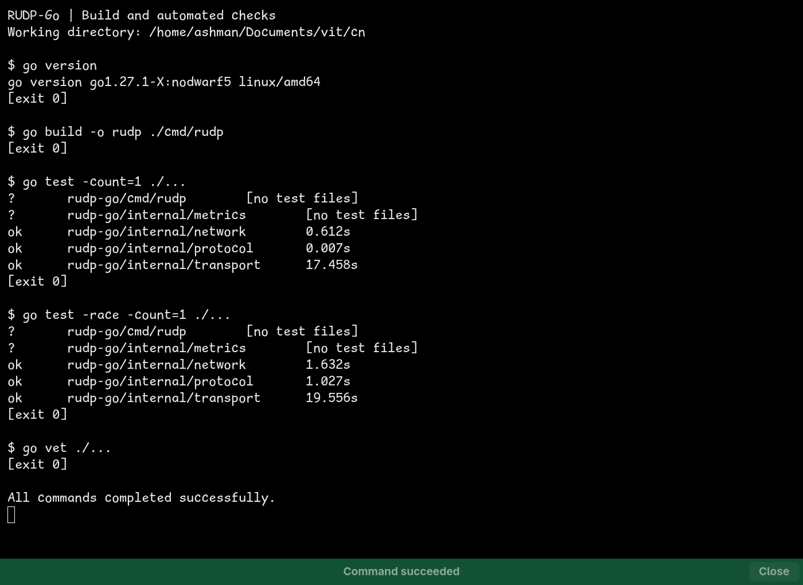
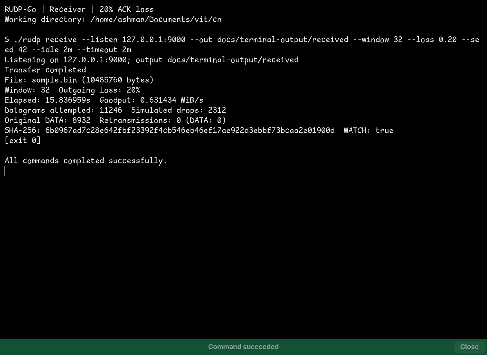
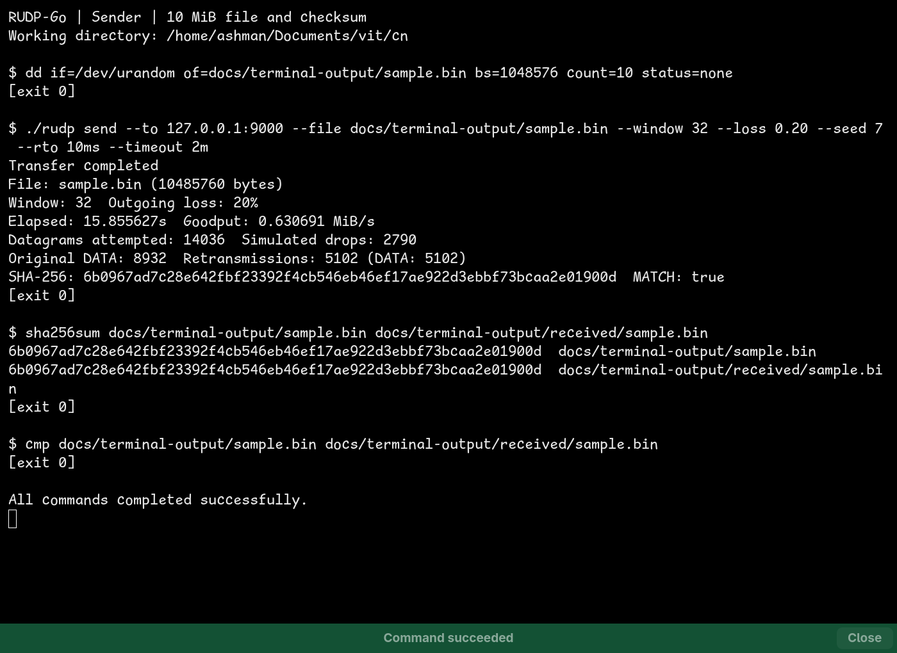
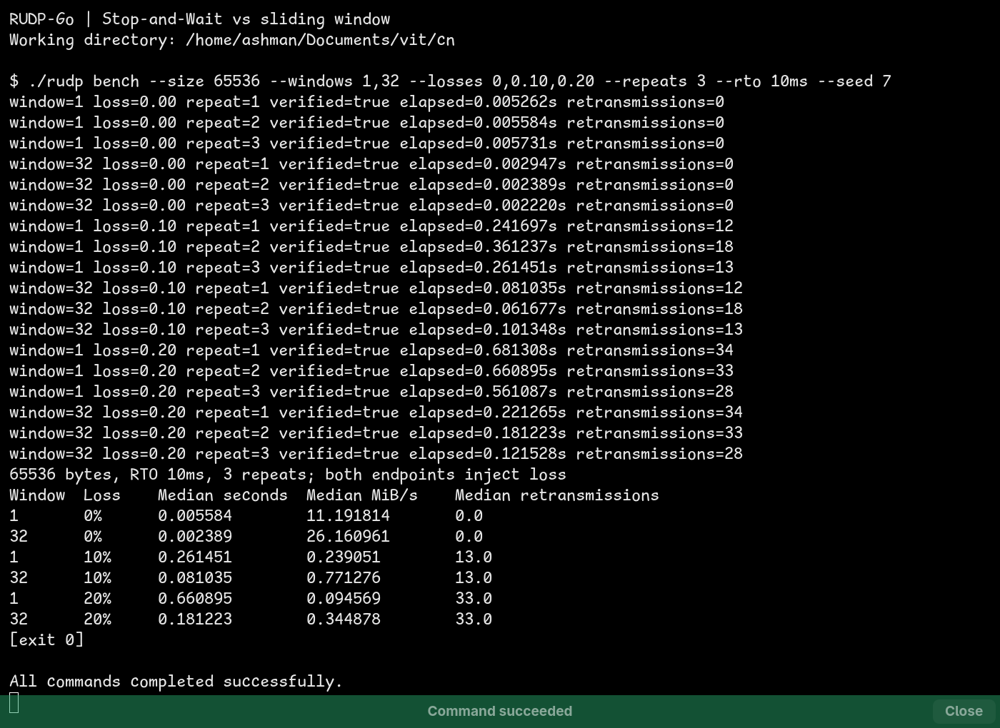

# RUDP-Go — Execution Output and Terminal Screenshots

## Capture provenance

These are fresh executions in dedicated **Ghostty terminal windows on the existing desktop**, captured directly with niri's window-screenshot command. The images are actual terminal captures, not generated terminal mockups or replays of previous output. Only the project evidence windows were captured; existing terminal sessions and other applications were excluded.

The command runner prints each executed command with `$` and its actual exit status with `[exit N]`. The green **Command succeeded** strip belongs to Ghostty. Complete, copyable text transcripts accompany every screenshot, and [capture metadata](docs/terminal-output/capture.json) records the executed argument lists, exit codes, image dimensions, and artifact checksums.

All commands below run from the repository root. Screenshots preserve the actual output, including measured timings; timing will vary on another run. No protocol implementation or default was changed for this report.

## 1. Build, unit/integration tests, race checks, and vet

```bash
go version
go build -o rudp ./cmd/rudp
go test -count=1 ./...
go test -race -count=1 ./...
go vet ./...
```

Every command exited successfully. `-count=1` runs the tests again instead of using cached test results. Packages marked `[no test files]` are reported as such, not counted as additional passing tests.



[Full build/test transcript](docs/terminal-output/01-build-tests.txt)

## 2. Receiver: file transfer with outgoing ACK loss

Start this command in the first terminal, then run the sender commands in the next section while it is listening:

```bash
./rudp receive --listen 127.0.0.1:9000 --out docs/terminal-output/received --window 32 --loss 0.20 --seed 42 --idle 2m --timeout 2m
```

The receiver drops outgoing ACK/FINACK datagrams according to its seeded loss generator. It verifies the finished file before publication and remains alive for its normal five-second completed-session linger before exiting. The screenshot was taken after that normal exit, not after force-stopping the receiver.



[Full receiver transcript](docs/terminal-output/02-receiver.txt)

## 3. Sender, independent SHA-256, and byte comparison

The second terminal generates a 10 MiB binary fixture and sends it with a 32-packet window. Sender-side loss also applies to outgoing datagrams. **Each endpoint has 20% configured outgoing loss**; that is not a claim of 20% combined DATA/ACK exchange loss.

```bash
dd if=/dev/urandom of=docs/terminal-output/sample.bin bs=1048576 count=10 status=none
./rudp send --to 127.0.0.1:9000 --file docs/terminal-output/sample.bin --window 32 --loss 0.20 --seed 7 --rto 10ms --timeout 2m
sha256sum docs/terminal-output/sample.bin docs/terminal-output/received/sample.bin
cmp docs/terminal-output/sample.bin docs/terminal-output/received/sample.bin
```

The sender's RTO is explicitly shortened to **10ms for localhost**; the normal default remains 500ms. The endpoint summaries show successful protocol verification. The subsequent `sha256sum` independently produces identical digests, and `cmp` exits with status zero: the files are byte-for-byte identical. Successful `cmp` is silent; its recorded exit status is the evidence, not missing output.



[Full sender/checksum transcript](docs/terminal-output/03-sender.txt)

## 4. Stop-and-Wait versus sliding-window benchmark

```bash
./rudp bench --size 65536 --windows 1,32 --losses 0,0.10,0.20 --repeats 3 --rto 10ms --seed 7
```

This is a **new screenshot-sized experiment**, separate from the earlier full-size matrix in [docs/results.md](docs/results.md). It uses a deterministic 64 KiB fixture, windows 1 and 32, three loss settings, and three repeats per setting. Loss is applied independently at both endpoints. All 18 trials report `verified=true`; the table contains medians measured in this execution.



[Full benchmark transcript](docs/terminal-output/04-benchmark.txt)

The wider window improved observed goodput at every loss setting in this run. Retransmission medians matched across the two windows for the chosen seeds: pipelining overlaps recovery stalls rather than removing the configured packet loss. These are localhost results without injected WAN delay, bandwidth limits, or congestion control.

## Reproduction and artifact notes

- Build `rudp` before running the transfer commands. The `docs/terminal-output` directory is already included with this report.
- The receiver and sender must overlap in time, in separate terminals. Start the receiver first. Port 9000 was available during this capture; choose the same free port at both endpoints if it is occupied on another run.
- Large generated source/received files were removed **after** independent verification and capture. Screenshots, complete transcripts, measured results, and capture metadata remain. Re-running the displayed `dd` command regenerates the source fixture; because it reads `/dev/urandom`, a new run will have a different SHA-256.
- Destination overwrite is refused by default. For subsequent runs, choose a fresh output directory or explicitly opt in to receiver `--overwrite`; do not assume an old output is a new successful transfer.
- The benchmark internally starts real UDP sender/receiver engines on loopback sockets. It stops completed receiver linger after receiving FINACK; the separate-terminal capture above exercises full normal linger.
- The loss seeds reproduce the PRNG decision streams, not exact timings or operating-system scheduling. Short RTOs here are explicit demonstration settings, not changes to protocol defaults.
- Evidence windows were closed after capture, and focus was restored to the previously active window. No existing terminal session was repurposed or closed.

For the wire format and architecture, see [docs/protocol.md](docs/protocol.md). For the larger measured matrix and its raw trials, see [docs/results.md](docs/results.md) and [docs/benchmark.json](docs/benchmark.json).
