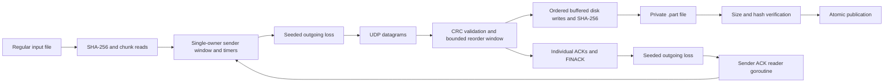

# RUDP version 1

## Architecture



The sender owns all pending slots, ACK state, retry counters, and outgoing metrics in one event loop. Its only worker reads replies into a bounded 256-entry channel; decoded replies never retain the reused receive buffer. The receiver uses one event loop and at most 128 × 1174 bytes of reorder payload storage, plus bounded metadata, socket/read buffers, and a buffered file writer. Neither endpoint retains the whole file or creates a goroutine per packet.

## Datagram layout

All integers are unsigned and big-endian. A UDP payload is at most 1200 bytes: a 26-byte fixed header plus at most 1174 payload bytes.

| Offset | Bytes | Field | Value/meaning |
|---|---|---|---|
| 0 | 2 | Magic | `0x5255` |
| 2 | 1 | Version | `1` |
| 3 | 1 | Type | START=1, DATA=2, ACK=3, FIN=4, FINACK=5, ERROR=6 |
| 4 | 8 | Session | Nonzero cryptographically random transfer ID |
| 12 | 4 | Seq | Packet sequence number |
| 16 | 4 | Ack | Exact sequence acknowledged |
| 20 | 2 | Payload length | Must equal bytes after the header |
| 22 | 4 | CRC32 | IEEE CRC32 over header bytes `[0:22]`, then payload bytes `[26:]` |

The CRC field is excluded, not zeroed and included. Decoder rejects short headers, truncated or trailing payloads, datagrams over 1200 bytes, unknown magic/version/type, bad CRC, zero sessions, and invalid per-type fields. Read buffers hold 1201 bytes, so a truncated oversized UDP datagram cannot masquerade as a valid 1200-byte frame. CRC is accidental-error detection, not authentication. `Decode` borrows its input payload; callers must consume or copy before reusing the buffer. `Encode` accepts reusable destination storage.

## Packet semantics

| Type | Seq | Ack | Payload |
|---|---|---|---|
| START | 0 | 0 | Nonempty JSON metadata |
| DATA | 1…N | 0 | Exactly the chunk length implied by metadata |
| ACK | 0 | 0…N | Empty; ACK(0) accepts START |
| FIN | N+1 | 0 | Empty |
| FINACK | 0 | N+1 | Empty; confirms verified publication |
| ERROR | 0 | 0 | Nonempty short error text |

START metadata keys: `filename` (basename), `size` (signed JSON integer interpreted as nonnegative int64), `sha256` (64 lowercase hexadecimal characters), and `chunk_size` (1–1174). The sender always uses chunk size 1174. Example shape:

```json
{"filename":"sample.bin","size":0,"sha256":"e3b0c44298fc1c149afbf4c8996fb92427ae41e4649b934ca495991b7852b855","chunk_size":1174}
```

`N = ceil(size/chunk_size)`, with N=0 for an empty file. N must not exceed `2^32-2`, leaving a sequence number for FIN. Filename length is 1–255 bytes. Empty names, `.`/`..`, either path separator, NUL, and names differing from `filepath.Base` are rejected. The sender strips its local directory with `filepath.Base` before creating metadata. The receiver never uses a peer-supplied path.

## Sender transitions

INIT hashes a regular file and generates the session ID. START_SENT retries START until ACK(0). TRANSFERRING maintains `base`, the first not-yet-contiguously-ACKed sequence, and `next`, the next sequence to send. Only sequences in `[base, base+window)` are sent. A ring of fixed payload slots retains bytes for retransmission; an ACK marks only its exact outstanding sequence. Duplicate, stale, and unsent-sequence ACKs do not release slots. Consecutively ACKed slots advance `base`; an ACK above a hole cannot move the sequence window past that hole.

A ticker checks every `min(25ms, RTO)`. Only unacknowledged expired packets are retransmitted, using their original bytes. Retransmission count is per packet, and the retry limit excludes the initial attempt. Once every DATA packet is ACKed, FIN_SENT retries FIN until matching FINACK. Any peer ERROR, read/write error, context cancellation, or exhausted packet budget enters FAILED. The sender sends a best-effort ERROR on failure. A matching FINACK enters COMPLETE and sets `verified=true`.

Only the connected UDP peer and selected session can supply replies. The reply-reader goroutine is canceled and joined before Send returns. There is no cumulative ACK, congestion-control algorithm, adaptive timer, or negotiated receiver capacity.

## Receiver transitions

1. Wait for valid START. Malformed metadata gets a best-effort ERROR but does not bind a session. A valid START binds session ID and original source IP/port. Other sessions/peers are ignored. One transfer is supported per receiver invocation.
2. Refuse an existing destination, including a symlink, unless overwrite was requested. Create a private `.rudp-*.part` file inside the output directory. ACK(0) only after successful setup. A repeated identical START receives ACK(0); changed metadata is terminal.
3. For DATA, require the exact expected chunk length and a sequence within the file. Already-written duplicates receive another ACK without disk writes. Within `[next, next+receive_window)`, copy out-of-order chunks into fixed reusable slots; write an in-order chunk directly, then drain contiguous buffered slots. ACK only accepted or duplicate data. Corrupt, oversized, future/out-of-window, and wrong-length datagrams receive no ACK.
4. Ignore premature/wrong-sequence FIN. For valid FIN after all bytes, flush the writer, check exact byte count and streaming SHA-256, sync and close the partial file, and publish. Hash/write/publication failure sends ERROR and removes the partial.
5. Without overwrite, publish using a same-directory hard link followed by unlinking the partial. The link fails rather than clobbering a destination created after START; there is no check-then-rename race. This requires a filesystem supporting hard links. With overwrite, use atomic same-directory `os.Rename`. Directory sync is best-effort after publication. Completed files retain the temporary file's private permissions.
6. Send FINACK and retain the original peer/session for at least five seconds. Duplicate FIN receives FINACK; late valid duplicate DATA receives ACK without touching output. Duration stops at publication, not at linger expiry. Cancellation during completed linger returns success because the file was already verified; cancellation earlier removes the partial and returns failure.

An idle timeout bounds both initial waiting and incomplete selected sessions. Unrelated peers and undecodable datagrams do not refresh the selected session. Retry, idle, and linger settings are not negotiated: configure receiver idle/linger long enough for the sender's chosen RTO and retry horizon. The default 15s idle and 5s linger are intended for the default 500ms RTO. Abrupt process termination can leave a partial but cannot turn it into a verified destination.

## Metrics and experiment boundaries

`datagrams_sent` counts all outgoing attempts, including simulated drops and control packets. `dropped` counts only locally simulated loss. Sender `original_data` counts first DATA attempts, and receiver `original_data` counts distinct accepted DATA chunks. `retransmissions` counts sender timer-driven START/DATA/FIN retries; `data_retransmissions` counts only DATA retries. Receiver ACKs are request-driven, so its retransmission counters remain zero even when a duplicate triggers another ACK.

Sender `duration_seconds` includes hashing and successful completion; receiver duration starts after START setup and stops at verified publication. `goodput_bps` is file bytes divided by that duration, not wire throughput. Successful JSON summaries contain `verified=true` and the SHA-256; failure exits nonzero with a diagnostic. Seeds fix the outgoing Bernoulli decision stream but not scheduler/UDP ordering or exact timings.
